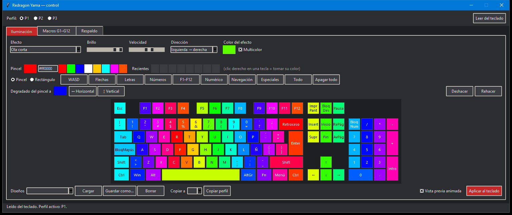
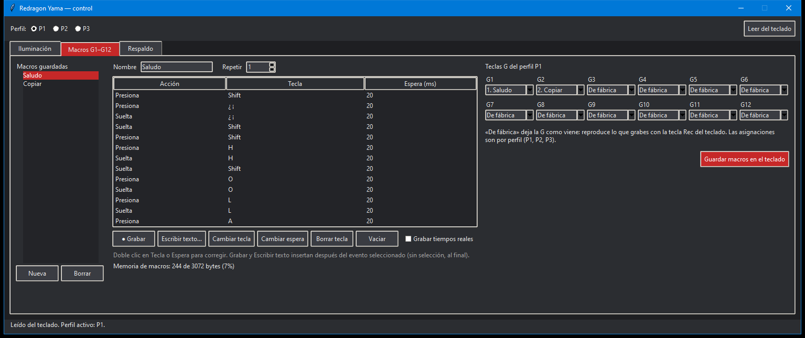

# Redragon Yama (K550RGB-1): control en español

Programa libre para controlar las luces y las macros del teclado **Redragon K550RGB-1 (Yama)**
en Windows. Reemplaza al programa oficial de Redragon y corrige sus fallas.

> **Distribución del teclado: Español Latinoamérica (ISO).**
> El programa dibuja y corrige el teclado **en español latinoamericano**: con **Ñ**, la tecla
> **`< >`** junto al Shift izquierdo y la tecla **`}`** junto al Enter. El programa oficial
> solo muestra el teclado en inglés (US) y no deja iluminar esas teclas.



## Qué corrige

| Problema del programa oficial | Causa | Con este programa |
|---|---|---|
| El **rojo y el verde salen cambiados** | El teclado espera el color en orden verde-rojo-azul y el programa lo manda como rojo-verde-azul | Los colores salen como los eliges |
| Solo muestra el **teclado en inglés (US)** | Su imagen y su configuración son de un teclado ANSI | Teclado **español latinoamericano (ISO)**: Ñ, `< >` y `}` se ven y se pueden iluminar |
| **No deja asignar macros a G1–G12** | En su configuración las teclas G vienen desactivadas | Cualquier macro en cualquier G, por perfil (P1, P2, P3) |

Además agrega:
- Macros generadas desde un texto, que respetan tu distribución de Windows: ñ, tildes y la @ con AltGr.
- Corrección de teclas en medio de una macro larga.
- Pintura por grupos, rectángulo y degradado.
- Diseños guardados, deshacer y rehacer.
- Vista previa animada de los efectos.
- Respaldo completo de la memoria del teclado.

## Requisitos

- **Windows 10 u 11.**
- **Python 3.10 o superior.** Descárgalo de [python.org](https://www.python.org/downloads/).
  Durante la instalación **marca la casilla «Add python.exe to PATH»**.
- El teclado **Redragon K550RGB-1 (Yama)** conectado por USB. En Windows aparece como
  «RGB Keyboard», con identificador USB `320F:5000`.

## Cómo instalarlo y abrirlo

1. Descarga el programa. Elige una de estas formas:
   - **Sin git:** en esta página, botón verde **Code → Download ZIP**, y descomprímelo
     donde quieras (por ejemplo en `Documentos`).
   - **Con git:**
     ```bash
     git clone https://github.com/aldoboomer/redragon-yama-control.git
     ```
2. **Cierra el programa de Redragon** si está abierto, también desde el área de notificaciones
   junto al reloj. Los dos hablan con el teclado y se pisan. Si ya no lo vas a usar, puedes desinstalarlo.
3. Abre la carpeta y haz **doble clic en `Yama.bat`**.
   - La primera vez aparece una ventana negra unos segundos mientras instala lo necesario
     (la librería `hidapi`, en una carpeta `.venv` dentro de la misma carpeta, sin tocar el resto del PC).
   - Las siguientes veces abre directamente.

Si prefieres usar la consola:

```bash
python -m venv .venv
.venv\Scripts\python -m pip install -r requirements.txt
.venv\Scripts\python -m yama
```

Todo queda guardado **en el teclado**, así que el programa no necesita quedar abierto ni arrancar con Windows.

## Cómo se usa

Arriba eliges el **perfil (P1, P2, P3)** que vas a editar. Las luces y las teclas G se configuran
por perfil, y en el teclado se cambia de perfil con las teclas P1–P3.

### Iluminación

- **Efecto**: fijo, respiración, olas, arcoíris, reactivos al pulsar, estrellas, etc. Cada efecto
  deja activos solo los controles que usa: velocidad, dirección, color o multicolor.
- **Personalizado** = un color por tecla:
  - Pinta con clic o arrastrando (*Pincel*), o una zona entera con *Rectángulo*.
  - Los botones de grupo pintan WASD, flechas, letras, números, F1–F12, numérico, navegación o especiales.
  - **Degradado** del color del pincel a un segundo color, horizontal o vertical.
  - Código hex, colores recientes y **clic derecho** en una tecla para tomar su color.
  - **Deshacer / Rehacer**: Ctrl+Z / Ctrl+Y.
- **Diseños**: guarda tus diseños con nombre y cárgalos después. **Copiar perfil** pasa la
  iluminación a otro perfil.
- **Vista previa animada**: muestra en pantalla cómo se mueve el efecto, de forma aproximada.
- Nada llega al teclado hasta que presionas **Aplicar al teclado**.

El modo Personalizado del teclado es estático. El firmware no permite animar colores
distintos por tecla: los efectos animados usan un solo color o el arcoíris.

### Macros en G1–G12



1. **Nueva** crea una macro. Ponle un nombre.
2. Llénala con **● Grabar** (tecleas la secuencia y luego **■ Detener**) o con **Escribir texto…**.
3. Para corregir, haz doble clic en la *Tecla* equivocada y presiona la correcta. **Borrar tecla**
   quita una pulsación completa. Lo que grabes o escribas se inserta después del evento seleccionado.
4. En el panel derecho elige qué **G** la ejecuta y presiona **Guardar macros en el teclado**.

- **De fábrica** deja la G como viene: reproduce lo que grabes directamente en el teclado con su tecla **Rec**.
- El teclado tiene **3.072 bytes** para todas las macros juntas, unas 350 pulsaciones simples.
  Abajo de la lista ves cuánto llevas usado.

### Respaldo

La primera vez que abres el programa se guarda un respaldo automático de todo lo que tenía el
teclado en `%APPDATA%\yama-control\respaldo-inicial.json`. Desde la pestaña **Respaldo** puedes
guardar otros y restaurarlos.

## Si tu Yama no es latinoamericano

- **Español de España (ISO):** funciona igual, porque las teclas están en las mismas posiciones.
  Solo cambian algunas etiquetas en pantalla, por ejemplo `Ç`.
- **Inglés (US, ANSI):** las luces y las macros funcionan, pero el dibujo no coincide del todo.
  Faltaría la tecla `< >` y el Enter tiene otra forma.
- **Macros de texto:** siempre usan la distribución que tengas activa en Windows, así que
  funcionan con cualquiera.

Si quieres agregar otra distribución, abre un *issue*. Las posiciones están en
[`yama/layout.py`](yama/layout.py).

## Problemas comunes

**La rueda de volumen no hace nada.** La rueda no depende de este programa: el teclado manda
las teclas estándar de subir y bajar volumen. Si Windows no reacciona, casi siempre hay otro
programa capturando las teclas de volumen:

- **Voicemeeter**: en *Menu → Shortcut Key (Hook)* desmarca **Hook Volume Keys**. Con esa
  opción activa, la rueda mueve el nivel de Voicemeeter en vez del volumen de Windows.
- **Discord** u otros programas con atajos globales: prueba cerrándolos.

Para confirmarlo, cierra esos programas y gira la rueda: debería aparecer el indicador de
volumen de Windows.

**«No encontré el Redragon Yama».** Revisa que el teclado esté conectado y que el programa de
Redragon esté cerrado, también desde el área de notificaciones junto al reloj.

## Advertencias

- **Probado solo con el Redragon K550RGB-1 (Yama).** Otros teclados de distintas marcas usan el
  mismo identificador USB `320F:5000`, pero pueden tener otra disposición interna. Con ellos el
  programa podría asignar mal las teclas G. Si lo pruebas con otro modelo, **guarda un respaldo antes**.
- El teclado guarda los colores en una memoria permanente que soporta una cantidad limitada de
  grabaciones, normalmente miles. Usarlo normalmente, incluso aplicando decenas de veces al día,
  no es un problema. Por la misma razón el programa no anima colores por tecla desde el PC.
- Proyecto independiente, **sin relación con Redragon**. Se usa bajo tu propio riesgo (ver [licencia](LICENSE)).

## Cómo funciona (protocolo)

Descifrado desde el ejecutable oficial (`Redragon K550RGB-1 Keyboard.exe`, 2022) y verificado en
el teclado. El detalle está en [`yama/device.py`](yama/device.py) y [`yama/macros.py`](yama/macros.py).

- USB `320F:5000`, colección HID vendor `0xFF1C/0x92`, paquetes de 64 bytes con report id `0x04`
  y checksum de 16 bits en los bytes 1–2.
- Comandos: `01` inicio, `02` fin, `03` capacidades, `05/06` leer o escribir la iluminación
  (bloques de `0x2A` por perfil), `07/08` mapa de teclas (`0x200` por perfil), `09/0A` macros,
  `10/11` colores por tecla (`0x200` por perfil, en orden **G, R, B**).
- Espacio para macros: byte 11 de las capacidades × 128. En el Yama son 3.072 bytes.
- Una tecla G con macro se guarda como `05 01 <índice>`. La de fábrica es `06 cc cc`, con `cc = 0x11 + n`.
- Los eventos de macro necesitan al menos 10 ms de espera. Con 0 ms el teclado se salta el evento.

Es la familia de chip que [OpenRGB](https://openrgb.org) llama «EVision». De su tabla sale qué
parámetros usa cada efecto.

## Desarrollo

```bash
.venv\Scripts\python -m unittest
```
